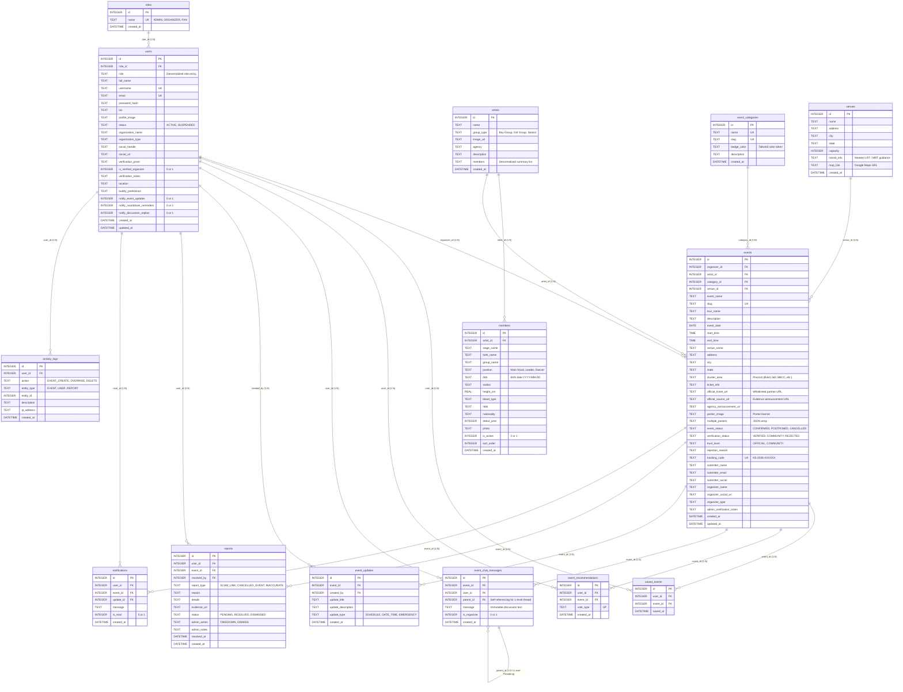

# K-Sync Malaysia — Database Entity-Relationship Diagram (ERD)

**Document Type:** Technical Database Specification (SRS Section 3.4)  
**Database Engines Supported:** SQLite 3 (Development / Local WAL Mode) & MySQL 8.0 (Production Hostinger)  
**Total Tables:** 14 Purposeful Application Tables (Zero Redundancy / 3NF Normalized)  
**Source of Truth:** Live running database `database/ksync.db` (verified via SQLite schema introspector).

---

## 1. Visual Entity-Relationship Diagram (Mermaid)

---

## 2. Table Catalog & Schema Dictionary

### 2.1 Identity & Authentication
1. **`roles`**: Master user roles (`ADMIN`, `ORGANIZER`, `FAN`).
2. **`users`**: Comprehensive user accounts supporting local Bcrypt authentication and Google OAuth 2.0. Includes verified organizer status flags and notification preference toggles (`notify_event_updates`, `notify_countdown_reminders`, `notify_discussion_replies`).

### 2.2 Master Taxonomies
3. **`artists`**: K-Pop boy groups, girl groups, and soloists with agency affiliations and banners.
4. **`members`**: 3NF-normalized idol member profiles linked to `artists` via `artist_id`. Stores stage name, birth name, group position, birth date, height, MBTI, blood type, and debut year.
5. **`event_categories`**: Event classification slugs (`concert`, `fanmeeting`, `cafe-event`, `cup-sleeve`) with Tailwind badge color mappings.
6. **`venues`**: Physical Malaysian event venues annotated with capacity and public transit instructions (e.g. Sri Petaling LRT line for Axiata Arena).

### 2.3 Core Event Management
7. **`events`**: The central transactional entity storing event schedule, venue location, ticketing URLs, source evidence URLs, multimodal poster paths, autonomous verification scores, trust badges, and geographical precinct tags (`cluster_area`).
8. **`event_updates`**: Official broadcast alerts posted by organizers for gate opening times, soundcheck queues, and emergency notices. Alerts fans who saved the event.

### 2.4 Community & Social Engagement
9. **`saved_events`**: Personal wishlists tracking events saved by fans for the "My K-Sync" dashboard and countdown alerts.
10. **`event_recommendations`**: Crowdsourced reliability upvoting records with unique compound index `(user_id, event_id)` enforcing one vote per fan.
11. **`event_chat_messages`**: Public discussion thread messages. Features self-referencing `parent_id` for strictly 1-level deep replies. **Strictly immutable (no edit capability)** to protect against secondary ticket scalping fraud.

### 2.5 Moderation & Auditing
12. **`reports`**: Community scam and misinformation reports filed by fans with status tracking (`PENDING`, `RESOLVED`, `DISMISSED`).
13. **`notifications`**: User-specific in-app notification alerts for schedule shifts, showtime countdowns, and discussion replies.
14. **`activity_logs`**: Immutable audit logs capturing administrative overrides, listings publications, and security actions.
