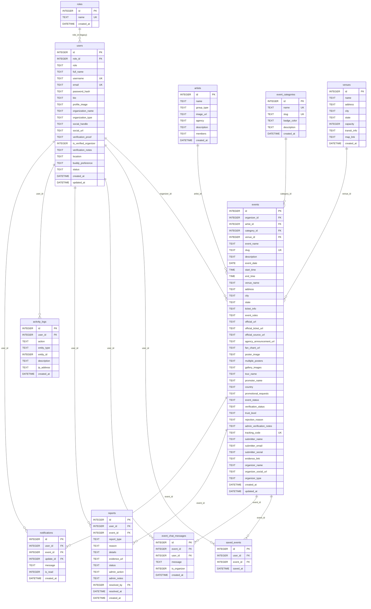

# K-Sync Malaysia — Database ERD

**Source of truth:** the live database the Node application runs on (`database/ksync.db`), 11 tables.
PlantUML source: [`diagrams/erd_ksync.puml`](diagrams/erd_ksync.puml) · rendered: `diagrams/erd_ksync.svg` / `diagrams/erd_ksync.png`.

> Note: `database/hostinger_mysql_schema.sql` is **stale** and does not match the live schema or the code. See "Schema consistency" at the end.

---

## Diagram

---

## Entities, keys & purpose

| Entity | PK | Foreign keys | Unique keys | Purpose |
|---|---|---|---|---|
| `roles` | `id` | — | `name` | Legacy role lookup (ADMIN / ORGANIZER / FAN) |
| `users` | `id` | `role_id → roles.id` (RESTRICT) | `username`, `email` | Accounts; `role` is the **active** role field |
| `artists` | `id` | — | — | Idol groups/soloists; `members` = JSON biodata |
| `event_categories` | `id` | — | `name`, `slug` | Concert / Fan Meeting / Cupsleeve … |
| `venues` | `id` | — | — | Venue directory |
| `events` | `id` | `organizer_id → users.id` (CASCADE), `artist_id → artists.id` (SET NULL), `category_id → event_categories.id` (RESTRICT), `venue_id → venues.id` (SET NULL) | `slug`, `tracking_code` | Central entity |
| `saved_events` | `id` | `user_id → users.id`, `event_id → events.id` (both CASCADE) | `(user_id, event_id)` | Bookmarks — **M:N** users↔events |
| `event_chat_messages` | `id` | `event_id → events.id`, `user_id → users.id` (CASCADE) | — | Public event forum |
| `reports` | `id` | `user_id → users.id` (SET NULL), `event_id → events.id` (CASCADE); `resolved_by` (logical → users) | — | Scam/violation reports |
| `activity_logs` | `id` | `user_id → users.id` (SET NULL); `entity_id` = polymorphic logical FK | — | Audit trail |
| `notifications` | `id` | `user_id → users.id` (CASCADE), `event_id → events.id` (CASCADE), `update_id → event_updates.id` **(table missing!)** | — | In-app notifications |

---

## Relationships (cardinality)

| # | Relationship | Cardinality | FK | On delete |
|---|---|---|---|---|
| R1 | roles → users | 1 : N | `users.role_id` | RESTRICT |
| R2 | users → events | 1 : N (organizer) | `events.organizer_id` | CASCADE |
| R3 | artists → events | 1 : N | `events.artist_id` | SET NULL |
| R4 | event_categories → events | 1 : N | `events.category_id` | RESTRICT |
| R5 | venues → events | 1 : N | `events.venue_id` | SET NULL |
| R6 | users ↔ events (via saved_events) | **M : N** | `saved_events.user_id` / `event_id` | CASCADE |
| R7 | users / events → event_chat_messages | 1 : N | `event_id`, `user_id` | CASCADE |
| R8 | users / events → reports | 1 : N | `user_id`, `event_id` | SET NULL / CASCADE |
| R9 | users → activity_logs | 1 : N | `user_id` | SET NULL |
| R10 | users / events → notifications | 1 : N | `user_id`, `event_id` | CASCADE |

---

## Schema consistency problems

Three conflicting definitions of the same database exist, and they do not match the code:

1. **`database/hostinger_mysql_schema.sql` is stale.** It has no `venues` table (venue is embedded in `events`), no `roles` table, and is missing columns the code actively writes:
   - `users.is_verified_organizer`
   - `reports.evidence_url`, `reports.admin_action`, `reports.admin_notes`, `reports.resolved_by`, `reports.resolved_at`
   - `event_chat_messages.is_organizer`
   - `activity_logs` uses `target_type/target_id/details` in MySQL but the code writes `entity_type/entity_id/description`
   - `notifications` has `title/link` in MySQL but the live DB has neither
2. **`notifications.update_id` → non-existent `event_updates` table** (dangling FK). With `PRAGMA foreign_keys = ON` (`config/database.js:47`), inserts into `notifications` can fail.
3. **Dual-role columns.** `users` has both `role_id` (NOT NULL → `roles`) and `role` (TEXT). The app reads/writes `role`, and dead code still tests `role_id = 1` (`helpers.js:285`, `auth.js:140`). The OTP/Google inserts (`auth.js:275,536`) omit `role_id`, so they violate `NOT NULL` on SQLite while working on the MySQL schema (which has no `role_id`).
