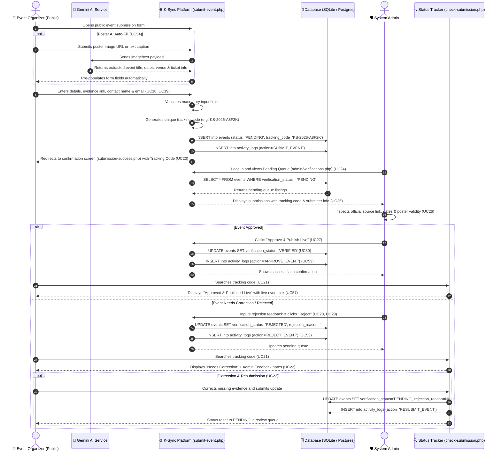

# K-Sync Malaysia: FYP Use Case Specification & Architecture Report

> **Project Title:** K-Sync Malaysia: A Centralized Platform for K-Pop Event Information and Fan Community Discussions  
> **Target Audience:** Academic Evaluators, FYP Supervisor, System Developers  
> **Architecture Model:** Model 2 — Open Public Submission without Account & Admin Verification Workflow  

---

## 1. Executive Summary

In Malaysia, K-Pop event information is fragmented across decentralized social media channels (Twitter/X, Instagram, Telegram channels, and fanclub forums). Fans frequently encounter unverified cupsleeve notices, outdated concert schedules, and fraudulent ticketing claims. 

**K-Sync Malaysia** solves this problem by providing a centralized, authoritative platform. The system operates under **Model 2 Architecture**:
1. **Event Organizers** (concert promoters, cafe owners, fanclub admins) can submit event information publicly **without creating an account**.
2. Submissions enter a secure **Verification Queue** with a unique **Tracking Reference Code** (e.g. `KS-2026-A8F2K`).
3. **System Admins** verify the official evidence, poster, and ticketing links before publishing listings live.
4. **Registered Fans** access personalized community features (bookmarks, event buddy matching, live event Q&A discussions).
5. **Guests** discover verified events and public details without login barriers.

---

## 2. System Actors Dictionary

| No. | Actor | Type | Description & System Scope |
| :--- | :--- | :--- | :--- |
| **1** | **Guest** | Human (Primary) | A visitor who can discover events, search, filter, view public event details, view verification badges, and browse public fan discussions without logging in. |
| **2** | **Registered Fan** | Human (Primary) | A fan who has created an account and logged in. Has access to personalized features: saving/bookmarking events, participating in discussions/Q&A, finding an Event Buddy, reporting violations, and managing notification settings. |
| **3** | **Event Organizer** | Human (Primary) | An individual or organization that submits K-Pop events through the public submission portal **without creating an account**. Tracks status, views admin feedback, and corrects/resubmits using their unique Reference Code. |
| **4** | **System Admin** | Human (Primary) | An authorized platform manager responsible for verifying pending submissions, recording approval/rejection reasons, managing live listings, moderating reports, reviewing audit logs, and maintaining platform categories and venues. |
| **5** | **Email Service** | Supporting External System | Optional notification service for dispatching submission receipts, status updates, and verification decisions. |
| **6** | **External AI Service** | Supporting External System | Google Gemini 1.5 Flash API that analyzes event posters or announcement text to auto-fill submission form fields (UC54). |

---

## 3. Interactive Use Case Diagram (Mermaid)

```mermaid
flowchart TB
    %% ACTORS
    subgraph ACTORS ["System Actors"]
        direction TB
        GUEST["👤 Guest"]
        FAN["👤 Registered Fan"]
        ORG["👤 Event Organizer<br/>(No Account Required)"]
        ADMIN["🛡️ System Admin"]
        AI["🤖 External AI Service<br/>(Gemini Flash)"]
    end

    %% SUBSYSTEMS
    subgraph PLATFORM ["K-Sync Malaysia System Boundary"]
        
        subgraph MOD_A ["A. Account & Auth"]
            UC01(["UC01: Register Account"])
            UC03(["UC03: Log In"])
            UC04(["UC04: Log Out"])
            UC05(["UC05: Manage Profile"])
            UC07(["UC07: Recover Account"])
        end

        subgraph MOD_B ["B. Event Discovery"]
            UC08(["UC08: Browse Events"])
            UC09(["UC09: Search Events"])
            UC10(["UC10: Filter Events"])
            UC11(["UC11: View Event Details"])
            UC12(["UC12: View Verification Status"])
            UC13(["UC13: Save / Bookmark Event"])
            UC14(["UC14: View Saved Events"])
            UC15(["UC15: View Discussion"])
        end

        subgraph MOD_C ["C. Public Submission (Model 2)"]
            UC17(["UC17: Submit Event"])
            UC18(["UC18: Provide Event Details"])
            UC19(["UC19: Provide Supporting Evidence"])
            UC20(["UC20: Receive Confirmation"])
            UC21(["UC21: Check Submission Status"])
            UC22(["UC22: Receive Decision Notification"])
            UC23(["UC23: Correct and Resubmit Event"])
            UC57(["UC57: View Status Timeline"])
        end

        subgraph MOD_D ["D. Admin Verification"]
            UC24(["UC24: View Pending Submissions"])
            UC25(["UC25: Review Event Submission"])
            UC26(["UC26: Check Supporting Evidence"])
            UC27(["UC27: Approve Submission"])
            UC28(["UC28: Reject Submission"])
            UC29(["UC29: Record Decision Reason"])
            UC30(["UC30: Publish Approved Event"])
        end

        subgraph MOD_E ["E. Published Event Management"]
            UC32(["UC32: Manage Published Events"])
            UC33(["UC33: Edit Event Info"])
            UC37(["UC37: Manage Venues & Artists"])
        end

        subgraph MOD_F ["F. Community & Discussions"]
            UC39(["UC39: Create Discussion Post"])
            UC41(["UC41: Reply to Discussion"])
            UC45(["UC45: Report Event / Post"])
            UC55(["UC55: Find Event Buddy"])
        end

        subgraph MOD_G ["G. Moderation & Audit"]
            UC47(["UC47: View Reports"])
            UC48(["UC48: Investigate Report"])
            UC49(["UC49: Take Action on Report"])
            UC50(["UC50: Moderate Content"])
            UC52(["UC52: View Audit Log"])
            UC53(["UC53: Record Admin Action"])
        end

        subgraph MOD_H ["H. AI Extensions"]
            UC54(["UC54: Auto-Fill Event from Poster"])
        end
    end

    %% GUEST ASSOCIATIONS
    GUEST --> UC01
    GUEST --> UC07
    GUEST --> UC08
    GUEST --> UC09
    GUEST --> UC10
    GUEST --> UC11
    GUEST --> UC12
    GUEST --> UC15

    %% REGISTERED FAN ASSOCIATIONS
    FAN --> UC03
    FAN --> UC04
    FAN --> UC05
    FAN --> UC08
    FAN --> UC11
    FAN --> UC13
    FAN --> UC14
    FAN --> UC39
    FAN --> UC41
    FAN --> UC45
    FAN --> UC55

    %% ORGANIZER ASSOCIATIONS (NO ACCOUNT)
    ORG --> UC17
    ORG --> UC21
    ORG --> UC22
    ORG --> UC54
    ORG --> UC57

    %% ADMIN ASSOCIATIONS
    ADMIN --> UC03
    ADMIN --> UC04
    ADMIN --> UC24
    ADMIN --> UC25
    ADMIN --> UC32
    ADMIN --> UC33
    ADMIN --> UC37
    ADMIN --> UC47
    ADMIN --> UC48
    ADMIN --> UC52

    %% EXTERNAL AI ASSOCIATION
    AI --> UC54

    %% UML «include» RELATIONSHIPS
    UC17 -.->|«include»| UC18
    UC17 -.->|«include»| UC19
    UC17 -.->|«include»| UC20
    UC25 -.->|«include»| UC26
    UC27 -.->|«include»| UC29
    UC28 -.->|«include»| UC29
    UC27 -.->|«include»| UC30
    UC27 -.->|«include»| UC53
    UC28 -.->|«include»| UC53
    UC48 -.->|«include»| UC47

    %% UML «extend» RELATIONSHIPS
    UC23 -.->|«extend»| UC21
    UC45 -.->|«extend»| UC11
    UC49 -.->|«extend»| UC48
    UC50 -.->|«extend»| UC48
```

---

## 4. System Activity Diagram: Event Submission & Verification Lifecycle

---

## 5. Formal Use Case Relationship Checklist

This checklist defines the strict UML direction and purpose for each `«include»` and `«extend»` relationship:

| Source Use Case | Relationship | Target Use Case | Justification & UML Direction |
| :--- | :--- | :--- | :--- |
| **Submit Event** | `«include»` | **Provide Event Details** | Event submission cannot complete without mandatory fields (title, date, venue). |
| **Submit Event** | `«include»` | **Provide Supporting Evidence** | To prevent spam and fake news, evidence links (official X/IG announcement) are required. |
| **Submit Event** | `«include»` | **Receive Submission Confirmation** | The system always issues a tracking reference number upon successful submission. |
| **Review Event Submission** | `«include»` | **Check Supporting Evidence** | Admin review always requires inspecting the submitted official link and poster. |
| **Approve Submission** | `«include»` | **Record Decision Reason** | Admin notes/decisions are documented for accountability. |
| **Reject Submission** | `«include»` | **Record Decision Reason** | Feedback is mandatory so the organizer understands why the event was rejected. |
| **Approve Submission** | `«include»` | **Publish Approved Event** | Approval immediately makes the event visible on the public discovery platform. |
| **Approve / Reject Submission** | `«include»` | **Record Administrative Action** | Every administrative decision is immutably logged into `activity_logs`. |
| **Investigate Report** | `«include»` | **View Reports** | Moderation begins by opening a pending item from the admin report queue. |
| **Report Event or Post** | `«extend»` | **View Event Details / Discussion** | Optional behavior; fans only trigger a report when they encounter suspicious or rule-breaking content. |
| **Take Action on Report** | `«extend»` | **Investigate Report** | Dismissal or removal occurs conditionally based on investigation findings. |
| **Moderate Discussion Content** | `«extend»` | **Investigate Report** | Hiding/deleting a post is an optional outcome when a report is substantiated. |
| **Correct and Resubmit Event** | `«extend»` | **Check Submission Status** | Resubmission is optional conditional behavior initiated only after an organizer discovers a rejected submission on the status tracker. |

---

## 6. How to Draw the Diagram in draw.io (Step-by-Step Guide)

If you need to produce the final diagram inside **diagrams.net / draw.io** for your written thesis report:

1. **Canvas Setup**:
   - Open [draw.io](https://app.diagrams.net).
   - In Page Setup, set Paper Size to **A3 Landscape** (recommended to comfortably fit all 4 subsystems and actors).
2. **System Boundary**:
   - Drag a large **Rectangle** onto the canvas. Set label to: `K-Sync Malaysia System Boundary`. Set fill to none or very light gray (`#FAFAFA`) and dashed/solid border.
3. **Placing Actors**:
   - Left side: Place `Guest` (top-left), `Registered Fan` (middle-left), `Event Organizer` (bottom-left).
   - Right side: Place `System Admin` (top-right), `Email Service` (middle-right), `External AI Service` (bottom-right).
4. **Drawing Packages (Subsystems A through H)**:
   - Group the ovals inside labeled subsystem containers (e.g., *A. Account*, *B. Discovery*, *C. Public Submission*, *D. Admin Review*, etc.).
5. **Connector Formatting (Crucial for FYP Marks)**:
   - **Actor to Use Case**: Solid line without arrows (`Actor — UseCase`).
   - **«include»**: Dashed line with open arrow pointing **FROM base TO included use case** (`Source ---> Target`), labeled `«include»`.
   - **«extend»**: Dashed line with open arrow pointing **FROM extending TO base use case** (`Extending ---> Base`), labeled `«extend»`.

---

## 7. FYP Presentation & Viva Defense Talking Points

When defending your project in front of examiners, emphasize these core architecture strengths:

1. **Why Model 2 (Submission Without Account)?**
   > *"In the K-Pop fan community, many grassroots cup sleeve and birthday projects are organized by ad-hoc fans or cafe owners who do not want the friction of account registration. Model 2 maximizes event contributions while preserving platform integrity through admin gatekeeping and tracking codes."*
2. **How is Spam and Fake Event Misinformation Prevented?**
   > *"No event is published automatically. Every submission enters a PENDING state and requires official source links (UC19). System admins verify official promoter/agency announcements before publishing (UC26, UC30)."*
3. **How Does the Organizer Track Decisions Without Logging In?**
   > *"Upon submission, the system generates a cryptographic 5-character reference code (`KS-2026-XXXXX`). Organizers use `check-submission.php` to monitor a 4-step visual milestone timeline (UC57). If rejected, the admin's constructive feedback is displayed, enabling one-click correction and resubmission (UC23)."*
4. **Accountability & System Auditing**:
   > *"All approval, rejection, and report actions are immutably logged into `activity_logs` with admin user ID, timestamp, and IP address (UC52, UC53), satisfying non-repudiation requirements."*
