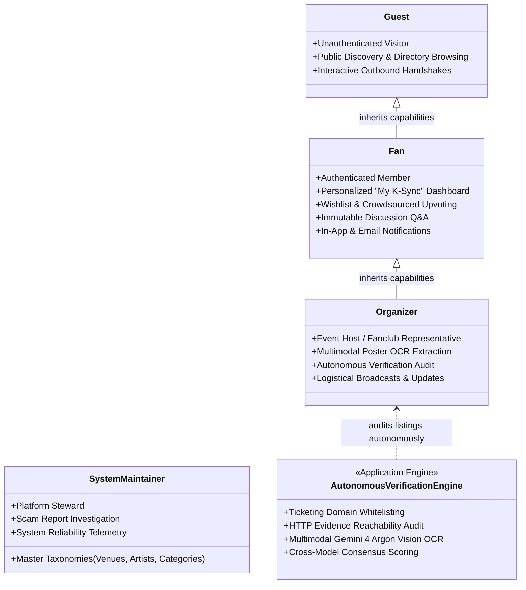

# K-Sync Malaysia: Complete System Use Case Descriptions (All 42 Use Cases)

**Project Title:** K-Sync Malaysia: A Centralized Platform for K-Pop Event Information and Fan Community Discussions  
**Document Type:** Detailed Software Requirements Specification (SRS) — Use Case Descriptions  
**Architecture Version:** 2.0 (Autonomous Verification Engine, Event Radar, Artist Profiles & Fan Command Center)  
**Total Use Cases:** 42 Use Cases across 5 Architectural Modules  
**Actors:** 4 Human Actors (`Guest`, `Fan`, `Organizer / Submitter`, `System Maintainer`) + 1 Automated Engine (`Autonomous Verification Engine`)  
**Design System Conformance:** Impeccable Design System (`PRODUCT.md`, `DESIGN.md`) — Electric Violet & Cyber Pink Accents, Dark Slate Typography, Accessible Contrast $\ge 4.5:1$.  
**Supervisor Directives:**
1. **Zero Admin Bottlenecks:** No manual admin event approval queues; listings are autonomously audited and scored via rule heuristics and OpenRouter Gemini 4 Argon OCR.
2. **Account Accountability:** No anonymous guest submissions; organizers submit under authenticated profiles with verified contact trails.
3. **Pure Business Modeling:** Technical Login/Logout mechanisms excluded from business use case catalog.
4. **Outbound Portals Modeled:** Interactive external buttons (Ticket Link, Map & Transit, Share, Organizer Socials, Calendar Export) are explicitly specified.
5. **Anti-Scalper Immutability:** Discussion comments support 1-level threaded Q&A and deletion, but **editing is strictly prohibited** to prevent secondary ticket scalping and link hijacking.

---

## 1. System Actors & Role Hierarchy

| Actor | Category | Role Description & Permitted Scope |
| :--- | :--- | :--- |
| **Guest** | Unauthenticated Public Visitor | Discovers Malaysian K-pop events, inspects event dossiers, browses idol directories, reads public discussion logs, explores Event Radar precinct clusters, and triggers outbound handshakes (Official Ticketing Whitelist, Google Maps Transit, Socials, Calendar Export). |
| **Fan** | Authenticated Member (inherits Guest) | Manages personal profile, monitors upcoming events on the personalized "My K-Sync" dashboard with live digital countdown timers, saves events to wishlist, upvotes listing reliability, posts inquiries in discussions, replies (1-level nesting), deletes own comments, and configures alert preferences. |
| **Organizer / Submitter** | Authenticated Event Host (inherits Fan) | Creates and publishes event listings assisted by OpenRouter Gemini 4 Argon Multimodal OCR, views detailed 14-point verification breakdowns, issues emergency logistical updates to ticket holders, and requests verified organizer credentials. |
| **System Maintainer** | Platform Administrator | Governs global system integrity, manages master taxonomies (venues with transit metadata, artists with member rosters, event categories), audits community scam reports, and enforces platform suspensions. |
| **Autonomous Verification Engine** | Automated Application Engine | Continuously verifies submitted listings in real-time: checks whitelisted ticketing providers, tests evidence URL resolution, runs multimodal poster OCR, computes attribute match metrics, and cross-checks AI consensus. |

---

## 2. Master Use Case Summary Index

| ID | Use Case Name | Module | Primary Actor | Implementation Endpoint |
| :--- | :--- | :--- | :--- | :--- |
| **UC001** | Register Account | 1. Public Discovery | Guest | `GET /register`, `POST /register` |
| **UC002** | Browse Events Directory | 1. Public Discovery | Guest | `GET /events` |
| **UC003** | Search Events | 1. Public Discovery | Guest | `GET /events?search={keyword}` |
| **UC004** | Filter Events | 1. Public Discovery | Guest | `GET /events?category={cat}&artist={id}&state={state}` |
| **UC005** | View Event Radar | 1. Public Discovery | Guest | `GET /events/radar` |
| **UC006** | View Event Details | 1. Public Discovery | Guest | `GET /events/:idOrSlug` |
| **UC007** | Open Official Ticket Link | 1. Public Discovery | Guest | Outbound Link Handshake (`views/event-details.ejs`) |
| **UC008** | Open Venue Map & Transit Route | 1. Public Discovery | Guest | Outbound Google Maps Navigation |
| **UC009** | Open Organizer Social Profile Link | 1. Public Discovery | Guest | Outbound Verified Social Handle |
| **UC010** | Share Event | 1. Public Discovery | Guest | Modal (`WhatsApp`, `X`, `Telegram`, Clipboard) |
| **UC011** | Export Event to Calendar | 1. Public Discovery | Guest | `GET /api/events/:id/calendar.ics` |
| **UC012** | Browse Artists Directory | 1. Public Discovery | Guest | `GET /artists` |
| **UC013** | View Artist & Member Profiles | 1. Public Discovery | Guest | `GET /artists/:idOrSlug` |
| **UC014** | View Event Discussion & Comments | 1. Public Discovery | Guest | `GET /events/:idOrSlug#discussion` |
| **UC015** | Manage Personal Profile | 2. Personal Management | Fan | `GET /profile`, `POST /profile` |
| **UC016** | View Personalized Dashboard ("My K-Sync") | 2. Personal Management | Fan | `GET /dashboard` |
| **UC017** | Bookmark / Save Event | 2. Personal Management | Fan | `POST /api/events/:id/save` |
| **UC018** | Recommend / Upvote Event | 2. Personal Management | Fan | `POST /api/events/:id/recommend` |
| **UC019** | Report Suspicious Listing | 2. Personal Management | Fan | `POST /api/events/:id/report` |
| **UC020** | Post Discussion Comment | 2. Personal Management | Fan | `POST /api/chat/:eventId` |
| **UC021** | Reply to Discussion Comment | 2. Personal Management | Fan | `POST /api/chat/:eventId` (`parent_id`) |
| **UC022** | Delete Own Discussion Comment | 2. Personal Management | Fan | `DELETE /api/chat/:messageId` (Immutability enforced) |
| **UC023** | View In-App Notifications | 2. Personal Management | Fan | `GET /notifications` |
| **UC024** | Mark Notification as Read | 2. Personal Management | Fan | `POST /notifications/:id/read` |
| **UC025** | Manage Notification Settings | 2. Personal Management | Fan | `POST /profile/notifications` |
| **UC026** | View Organizer Dashboard | 3. Event Publishing | Organizer | `GET /organizer/dashboard` |
| **UC027** | Submit Event Listing | 3. Event Publishing | Organizer | `GET /submit-event`, `POST /submit-event` |
| **UC028** | Edit Event Listing | 3. Event Publishing | Organizer | `GET /events/:id/edit`, `POST /events/:id/edit` |
| **UC029** | View Verification Breakdown | 3. Event Publishing | Organizer | `GET /events/:id/verification` |
| **UC030** | Post Logistical Event Update | 3. Event Publishing | Organizer | `POST /api/events/:id/updates` |
| **UC031** | Request Organizer Badge | 3. Event Publishing | Organizer | `POST /profile/request-organizer` |
| **UC032** | View Maintainer Portal | 4. Platform Governance | Maintainer | `GET /admin` |
| **UC033** | Manage Event Categories | 4. Platform Governance | Maintainer | `GET /admin/categories`, `POST /admin/categories` |
| **UC034** | Manage Venues Database | 4. Platform Governance | Maintainer | `GET /admin/venues`, `POST /admin/venues` |
| **UC035** | Manage Artists & Member Roster | 4. Platform Governance | Maintainer | `GET /admin/artists`, `POST /admin/artists` |
| **UC036** | Audit Scam Reports | 4. Platform Governance | Maintainer | `GET /admin/reports`, `POST /admin/reports/:id/action` |
| **AV01** | Audit Whitelisted Ticketing Domain | 5. Autonomous Verification | AutoVerifier | `services/verificationService.js:checkTicketingWhitelist` |
| **AV02** | Resolve Evidence URL & Readability | 5. Autonomous Verification | AutoVerifier | `services/verificationService.js:resolveEvidenceUrl` |
| **AV03** | Verify Date & Time Validity | 5. Autonomous Verification | AutoVerifier | `services/verificationService.js:verifyDateValidity` |
| **AV04** | Check Duplicate Event Listings | 5. Autonomous Verification | AutoVerifier | `services/verificationService.js:checkDuplicates` |
| **AV05** | Multimodal OCR Vision Extraction | 5. Autonomous Verification | AutoVerifier | `services/aiService.js:extractEventFromPoster` |
| **AV06** | Cross-Model AI Consensus Audit | 5. Autonomous Verification | AutoVerifier | `services/aiService.js:verifyListingConsensus` |

---

## 3. Detailed Specifications: Module 1 — Public Discovery & Outbound Experience (Guest)

### UC001: Register Account
* **Actor:** Guest
* **Description:** A public visitor signs up for a K-Sync Malaysia account using email or Google OAuth to transition to an authenticated Fan or Organizer.
* **Preconditions:** The visitor is unauthenticated.
* **Postconditions:** A new user record is inserted with `role_id = 3` ('Fan') and an authenticated session is established.
* **Priority:** High | **Frequency:** Once per new user
* **Normal Course of Events:**
  1. *Actor:* Clicks "Register" in top navigation bar.
  2. *System:* Renders registration form (`/register`) requesting Full Name, Username, Email, Password, and Role Preference (Fan / Organizer).
  3. *Actor:* Submits valid credentials.
  4. *System:* Validates email syntax, hashes password with Bcrypt (cost 10), persists record in `users`, initializes session cookie, and redirects to Dashboard with welcome toast.
* **Alternative Courses:**
  * 3a. *Google OAuth:* Visitor clicks "Continue with Google". System executes OAuth 2.0 handshake, retrieves verified email, creates profile, and signs user in.
* **Exceptions:**
  * E1: Email or username already registered. System highlights field with conflict alert.
  * E2: Password under 6 characters. System prompts user to strengthen password.
* **Includes:** N/A | **Notes:** Conforms to RFC 5322 email validation.

---

### UC002: Browse Events Directory
* **Actor:** Guest
* **Description:** Visitor browses the comprehensive chronological directory of all confirmed and community K-pop events in Malaysia.
* **Preconditions:** Platform database is online.
* **Postconditions:** System presents paginated event cards with verification badges, show dates, and venue precincts.
* **Priority:** High | **Frequency:** Very Frequent
* **Normal Course of Events:**
  1. *Actor:* Navigates to `/events` or clicks "Events" in header.
  2. *System:* Retrieves active events from `events` table ordered by `start_date ASC`, annotates with artist thumbnails and venue names, and renders grid layout.
  3. *Actor:* Scrolls through chronological listings and views headline tags (`VERIFIED_OFFICIAL`, `COMMUNITY_UNVERIFIED`).
* **Alternative Courses:**
  * 2a. *Zero Events Found:* System renders an empty-state illustration suggesting custom filter resets.
* **Exceptions:**
  * E1: Database offline. System serves cached fallback with graceful retry banner.
* **Includes:** N/A | **Notes:** Adheres to Impeccable Card Elevation tokens (`shadow-sm`, hover lift).

---

### UC003: Search Events
* **Actor:** Guest
* **Description:** Finds specific Malaysian K-pop listings by submitting keywords matching artist name, group name, event title, venue name, or host city.
* **Preconditions:** Guest is on an event directory page.
* **Postconditions:** Displays matching events or an informative zero-results suggestion.
* **Priority:** High | **Frequency:** High
* **Normal Course of Events:**
  1. *Actor:* Types query (e.g. "BOYNEXTDOOR" or "Axiata") into the search input.
  2. *System:* Debounces input and executes SQL `LIKE %query%` search across `title`, `artist_name`, `venue_name`, and `city`.
  3. *System:* Renders filtered results cards and displays query badge with match count.
* **Alternative Courses:**
  * 2a. *No Matches:* System displays "No events found matching '[query]'" with quick suggestions to clear search or browse all upcoming tours.
* **Exceptions:**
  * E1: Special characters / SQL injection attempt. System sanitizes input via parameterized prepared statements.
* **Includes:** N/A | **Notes:** Fully case-insensitive utf8mb4 lookup.

---

### UC004: Filter Events
* **Actor:** Guest
* **Description:** Refines event directory listings by category (Concert, Fanmeeting, Birthday Cafe, Cup Sleeve), artist roster, Malaysian state (Kuala Lumpur, Selangor, Penang, Johor), or precinct cluster.
* **Preconditions:** Events directory loaded.
* **Postconditions:** URL updates with filter query params and view renders matching subset.
* **Priority:** High | **Frequency:** High
* **Normal Course of Events:**
  1. *Actor:* Selects filter pills (e.g., Category: "Concert", State: "Kuala Lumpur").
  2. *System:* Submits filter parameters to `/events`, builds composite `WHERE` clause, and updates the display.
  3. *Actor:* Inspects refined results.
* **Alternative Courses:**
  * 1a. *Clear Filters:* Actor clicks "Reset Filters"; system restores default upcoming chronology.
* **Exceptions:**
  * E1: Invalid query parameter supplied. System ignores unknown params and applies standard defaults.
* **Includes:** N/A | **Notes:** Implemented via server-side query builder with clean URL state persistence.

---

### UC005: View Event Radar
* **Actor:** Guest
* **Description:** Explores events grouped by geographical precinct corridors (Bukit Jalil Hub, BBCC & Downtown KL, Mega Star Arena, PJ/Sunway) and temporal same-weekend cohorts to facilitate inter-fandom travel and meetup logistics.
* **Preconditions:** Active listings exist in the database.
* **Postconditions:** System displays the interactive Event Radar dashboard grouped by geographic precinct and temporal weekend windows.
* **Priority:** High | **Frequency:** Regular
* **Normal Course of Events:**
  1. *Actor:* Clicks "Event Radar" in the navigation bar (`/events/radar`).
  2. *System:* Queries events, calculates `cluster_area`, aggregates listings by geographic hub, and groups events sharing calendar weekends (`strftime('%Y-W%W', start_date)`).
  3. *System:* Renders precinct summary cards with venue counts, total artists, and weekend timeline badges.
  4. *Actor:* Clicks a precinct to filter listings occurring in that specific corridor.
* **Alternative Courses:**
  * 3a. *Empty Corridor:* System collapses inactive hubs and emphasizes active clusters.
* **Exceptions:**
  * E1: Event lacks cluster tag. System assigns to "Kuala Lumpur Metro Hub" fallback corridor.
* **Includes:** N/A | **Notes:** Directly implements survey requirement for regional clustering and transit planning.

---

### UC006: View Event Details
* **Actor:** Guest
* **Description:** Views full event dossier containing headline poster, live digital countdown timer, schedule, venue transit tips, verified evidence sources, organizer contact trail, and discussion thread.
* **Preconditions:** Requested event exists in database.
* **Postconditions:** Dossier rendered with real-time countdown clock and verification status pill.
* **Priority:** High | **Frequency:** Extremely High
* **Normal Course of Events:**
  1. *Actor:* Clicks on an event card from directory or radar.
  2. *System:* Resolves event by ID or slug (`/events/:idOrSlug`), fetches venue transit details, artist biodata, latest logistical updates, and community discussion comments.
  3. *System:* Calculates time delta from current UTC timestamp to showtime and initializes live ticking countdown (Days : Hours : Mins : Secs).
  4. *Actor:* Inspects event dossier, ticketing schedule, verified evidence URL, and crowd reliability score.
* **Alternative Courses:**
  * 2a. *Event is Past:* System renders "Event Concluded" banner and disables active ticket countdown.
* **Exceptions:**
  * E1: Event ID not found. System returns 404 page with link back to Events directory.
* **Includes:** N/A | **Notes:** Integrates Web Share API and structured JSON-LD schema for search indexing.

---

### UC007: Open Official Ticket Link
* **Actor:** Guest
* **Description:** Navigates directly to the external authorized Malaysian ticketing partner website (BookMyShow, GoLive Asia, Ticket2U, BigTix) with partner domain validation.
* **Preconditions:** Event has an official ticketing URL configured.
* **Postconditions:** External ticketing site opens in a secure new browser tab (`rel="noopener noreferrer"`).
* **Priority:** High | **Frequency:** High
* **Normal Course of Events:**
  1. *Actor:* Clicks the "Buy Official Tickets" button on the event dossier.
  2. *System:* Verifies URL is well-formed HTTPS and displays outbound domain verification pill (e.g. `golive-asia.com - Whitelisted Partner`).
  3. *Actor:* Tab opens to the primary vendor checkout portal.
* **Alternative Courses:**
  * 1a. *Free / Walk-in Event:* Button displays "Free Admission / Walk-in" and opens organizer notice page.
* **Exceptions:**
  * E1: External ticket link is broken or domain dead. System prompts user to use "Report Listing" modal.
* **Includes:** N/A | **Notes:** Strictly models outbound interactive button as directed by supervisor.

---

### UC008: Open Venue Map & Transit Route
* **Actor:** Guest
* **Description:** Opens Google Maps transit navigation pre-loaded with destination venue coordinates, LRT/MRT transit stop guidelines, and parking advice.
* **Preconditions:** Event venue has valid address or geographical coordinates.
* **Postconditions:** Opens external Google Maps routing portal with public transit presets.
* **Priority:** Medium | **Frequency:** High
* **Normal Course of Events:**
  1. *Actor:* Clicks "Get Transit Directions / Open Map" in the Venue section.
  2. *System:* Generates Google Maps search URL: `https://www.google.com/maps/search/?api=1&query={encoded_venue_address}`.
  3. *Actor:* Launches Google Maps app or browser navigation to review LRT/MRT routes (e.g., Sri Petaling LRT for Axiata Arena).
* **Alternative Courses:**
  * N/A
* **Exceptions:**
  * E1: Address missing. System defaults query to venue name and host city.
* **Includes:** N/A | **Notes:** Fulfills survey demand for integrated transit navigation.

---

### UC009: Open Organizer Social Profile Link
* **Actor:** Guest
* **Description:** Inspects official organizer and promoter social channels (X / Twitter, Instagram) to verify official tour announcements, gate opening notices, and merchandise guidelines.
* **Preconditions:** Event record has organizer social handle or URL configured.
* **Postconditions:** Opens promoter's official profile in external browser tab.
* **Priority:** Medium | **Frequency:** Medium
* **Normal Course of Events:**
  1. *Actor:* Clicks on organizer social handle badge (e.g. `@ime.malaysia` or `@livenation.my`).
  2. *System:* Opens destination social URL securely with outbound referral headers stripped.
  3. *Actor:* Reviews promoter feed for live event notices.
* **Alternative Courses:**
  * N/A
* **Exceptions:**
  * E1: Social link unconfigured. Button displays organizer organization name as text.
* **Includes:** N/A | **Notes:** Enhances transparency and community verification.

---

### UC010: Share Event
* **Actor:** Guest
* **Description:** Shares the event dossier across social platforms (WhatsApp, X, Telegram) or copies formatted share link to the system clipboard.
* **Preconditions:** Guest is viewing an event details page.
* **Postconditions:** Native share drawer opens or shareable URL copied with confirmation toast.
* **Priority:** Medium | **Frequency:** High
* **Normal Course of Events:**
  1. *Actor:* Clicks "Share Event" button on event header.
  2. *System:* Opens Share Modal presenting WhatsApp direct send, X post generator, Telegram forwarder, and "Copy Link" action.
  3. *Actor:* Selects "Copy Link".
  4. *System:* Copies `https://ksync.my/events/{id}` to clipboard and renders "Link Copied to Clipboard!" toast.
* **Alternative Courses:**
  * 3a. *Mobile Browser:* If `navigator.share` is supported, system triggers native OS share sheet.
* **Exceptions:**
  * E1: Clipboard API permission denied. System displays selectable input box for manual copy.
* **Includes:** N/A | **Notes:** Built with lightweight client-side micro-interactions.

---

### UC011: Export Event to Calendar
* **Actor:** Guest
* **Description:** Exports the event schedule and venue details directly to Google Calendar or downloads an RFC 5545 `.ics` file for Apple Calendar and Outlook.
* **Preconditions:** Event possesses valid start and end dates.
* **Postconditions:** Calendar export link opens or `.ics` file downloads to client machine.
* **Priority:** Medium | **Frequency:** Medium
* **Normal Course of Events:**
  1. *Actor:* Clicks "Add to Calendar" dropdown on event details page.
  2. *Actor:* Selects "Google Calendar" or "Download iCal (.ics)".
  3. *System:* For Google: constructs web intent URL containing title, dates in ISO 8601 UTC, venue address, and K-Sync source link. For iCal: streams `.ics` file with correct MIME type `text/calendar`.
  4. *Actor:* Saves calendar entry with pre-configured alarm reminders.
* **Alternative Courses:**
  * N/A
* **Exceptions:**
  * E1: Missing end date. System defaults event duration to 3 hours from start time.
* **Includes:** N/A | **Notes:** Directly implements FYP survey feature request.

---

### UC012: Browse Artists Directory
* **Actor:** Guest
* **Description:** Explores the directory of K-pop artists, idol boy groups, girl groups, and soloists with tours or fan events in Malaysia.
* **Preconditions:** Artists catalog populated in database.
* **Postconditions:** Displays catalog cards featuring artist banners, agency labels, and member rosters.
* **Priority:** High | **Frequency:** Regular
* **Normal Course of Events:**
  1. *Actor:* Clicks "Artists" in main navigation (`/artists`).
  2. *System:* Retrieves all artists from `artists` table, annotates with active upcoming Malaysian event counts, and displays responsive grid.
  3. *Actor:* Views idol profile cards and filters by group type (Boy Group, Girl Group, Soloist).
* **Alternative Courses:**
  * N/A
* **Exceptions:**
  * E1: Database unavailable. Renders empty catalog placeholder with refresh button.
* **Includes:** N/A | **Notes:** Uses normalized database structure with foreign keys to member records.

---

### UC013: View Artist & Member Profiles
* **Actor:** Guest
* **Description:** Inspects individual idol artist profile including agency affiliation, biography, debut year, normalized idol member biodata, and Malaysian tour history.
* **Preconditions:** Artist exists in database.
* **Postconditions:** Renders detailed idol profile dossier with connected Malaysian tour chronology.
* **Priority:** High | **Frequency:** Regular
* **Normal Course of Events:**
  1. *Actor:* Clicks on an artist card (e.g. "BOYNEXTDOOR" or "TOMORROW X TOGETHER").
  2. *System:* Resolves artist by ID or slug (`/artists/:idOrSlug`), queries `members` table for all affiliated idol members (stage name, real name, role, birth date), and fetches all linked Malaysian events.
  3. *System:* Displays artist biography, member cards, and past/upcoming concert timeline.
  4. *Actor:* Clicks a linked event to navigate directly to its full event dossier.
* **Alternative Courses:**
  * 2a. *Solo Artist:* Member roster section gracefully collapses to show solo profile highlights.
* **Exceptions:**
  * E1: Artist ID not found. System returns 404 with link back to Artists Directory.
* **Includes:** N/A | **Notes:** Normalized `members` table prevents comma-separated text bloat.

---

### UC014: View Event Discussion & Comments
* **Actor:** Guest
* **Description:** Reads public community discussions, ticketing Q&A, and logistics tips submitted by verified fans on an event listing.
* **Preconditions:** Event exists.
* **Postconditions:** Displays chronological comments with 1-level nested fan replies.
* **Priority:** High | **Frequency:** Extremely High
* **Normal Course of Events:**
  1. *Actor:* Scrolls to the "Community Discussion & Q&A" section on the event details page.
  2. *System:* Queries `event_chat_messages` where `event_id = :id` ordered by `created_at ASC`, nests reply messages under their respective `parent_id`, and marks verified organizer comments with official badges.
  3. *Actor:* Reads logistical advice (gate opening times, lightstick sync, bag checks).
* **Alternative Courses:**
  * 2a. *Zero Comments:* System displays prompt inviting logged-in fans to ask the first logistical inquiry.
* **Exceptions:**
  * E1: Comment author account deleted. Displays "Deleted User" with preserved discussion text.
* **Includes:** N/A | **Notes:** Public read-only access for guests; posting requires Fan authentication.

---

## 4. Detailed Specifications: Module 2 — Personal Management & Community Validation (Fan)

### UC015: Manage Personal Profile
* **Actor:** Fan
* **Description:** Manages personal profile details, including display name, username, bio, location, favorite K-pop groups, and password credentials.
* **Preconditions:** Fan is logged in.
* **Postconditions:** User record updated in `users` table and session refreshed.
* **Priority:** Medium | **Frequency:** Occasional
* **Normal Course of Events:**
  1. *Actor:* Navigates to `/profile` from user menu.
  2. *System:* Loads current profile data, notification toggles, and organizer verification status.
  3. *Actor:* Edits display name, bio, or favorite artists, and clicks "Save Profile".
  4. *System:* Validates input lengths, updates `users` record, and displays success banner.
* **Alternative Courses:**
  * 3a. *Change Password:* Actor inputs current password and new password; system verifies hash before updating.
* **Exceptions:**
  * E1: Current password mismatch. System rejects update with error message.
* **Includes:** N/A | **Notes:** Protects sensitive profile updates with CSRF tokens.

---

### UC016: View Personalized Dashboard ("My K-Sync")
* **Actor:** Fan
* **Description:** Views personal command center summarizing saved upcoming events, active ticking countdown to their next concert, crowdsourced upvoting history, and recent system alerts.
* **Preconditions:** Fan is logged in.
* **Postconditions:** Dashboard renders personalized timeline, live ticking clock, and saved event cards.
* **Priority:** High | **Frequency:** Frequent
* **Normal Course of Events:**
  1. *Actor:* Clicks "Dashboard" or "My K-Sync" in header (`/dashboard`).
  2. *System:* Queries `saved_events` joined with `events`, identifies nearest upcoming show date, fetches user's recommendation votes, and retrieves unread notification count.
  3. *System:* Renders primary digital countdown header ticking live towards nearest saved show.
  4. *Actor:* Manages saved bookings, tracks show dates, or navigates to event dossiers.
* **Alternative Courses:**
  * 2a. *No Saved Events:* System displays empty-state card with "Discover Upcoming Events" CTA button.
* **Exceptions:**
  * E1: Session expired. System redirects to login page with return URL preserved.
* **Includes:** N/A | **Notes:** Fulfills key survey requirement for personalized fan dashboard.

---

### UC017: Bookmark / Save Event
* **Actor:** Fan
* **Description:** Toggles bookmark status on an event listing to save it to their personal wishlist for quick access and automated schedule notifications.
* **Preconditions:** Fan is logged in and viewing an event.
* **Postconditions:** Event added to or removed from `saved_events` table; UI bookmark button updates state.
* **Priority:** High | **Frequency:** High
* **Normal Course of Events:**
  1. *Actor:* Clicks the Bookmark / Heart button on an event card or details page.
  2. *System:* Issues AJAX POST to `/api/events/:id/save`.
  3. *System:* Checks if record exists in `saved_events`. If present, deletes it (unsave); if absent, inserts it (save).
  4. *System:* Returns JSON response `{ saved: boolean, count: number }` and toggles UI icon color.
* **Alternative Courses:**
  * 1a. *Unauthenticated Guest Clicks Bookmark:* System prompts modal requesting guest to log in or register.
* **Exceptions:**
  * E1: Database write error. System returns 500 JSON with alert toast.
* **Includes:** N/A | **Notes:** Instant reactive UI update without page reload.

---

### UC018: Recommend / Upvote Event
* **Actor:** Fan
* **Description:** Casts a crowdsourced reliability vote (thumbs-up recommendation) on an event listing to signal community confidence in the listing's authenticity.
* **Preconditions:** Fan is logged in and event is published.
* **Postconditions:** Vote recorded in `event_recommendations` table and public recommendation count increments.
* **Priority:** High | **Frequency:** High
* **Normal Course of Events:**
  1. *Actor:* Clicks "Recommend Event" (thumbs up) on event details page.
  2. *System:* Dispatches POST to `/api/events/:id/recommend`.
  3. *System:* Toggles record in `event_recommendations` (`user_id`, `event_id`, `vote_type='UP'`).
  4. *System:* Re-aggregates total votes and returns updated recommendation tally and state.
* **Alternative Courses:**
  * 1a. *Retract Vote:* Actor clicks recommend button again; system removes vote and decrements count.
* **Exceptions:**
  * E1: User attempts to vote multiple times. Unique compound index `(user_id, event_id)` enforces one vote per user.
* **Includes:** N/A | **Notes:** Powers the community trust score displayed on each listing.

---

### UC019: Report Suspicious Listing
* **Actor:** Fan
* **Description:** Submits a formal moderation report flagging an event for suspected scam ticket links, fraudulent fan gatherings, or outdated show information.
* **Preconditions:** Fan is logged in.
* **Postconditions:** Report logged in `reports` table with status `PENDING` for maintainer review.
* **Priority:** High | **Frequency:** Low
* **Normal Course of Events:**
  1. *Actor:* Clicks "Report Event" button in event footer.
  2. *System:* Displays Report Modal with category options: "Scam / Fake Ticket Link", "Cancelled Event Not Updated", "Inaccurate Information", "Offensive Content".
  3. *Actor:* Selects reason, enters detailed explanation, and clicks "Submit Report".
  4. *System:* Inserts record into `reports` table (`event_id`, `user_id`, `reason`, `details`, `status='PENDING'`).
  5. *System:* Closes modal and displays confirmation toast: "Thank you. Our maintainers have received your report."
* **Alternative Courses:**
  * N/A
* **Exceptions:**
  * E1: Empty reason submitted. System blocks submission and highlights required field.
* **Includes:** N/A | **Notes:** If an event receives $>3$ active scam reports, the system automatically tags it with an amber caution warning.

---

### UC020: Post Discussion Comment
* **Actor:** Fan
* **Description:** Posts a top-level inquiry or logistical tip in the event's public discussion thread.
* **Preconditions:** Fan is logged in.
* **Postconditions:** Comment saved to `event_chat_messages` and broadcasted in discussion UI.
* **Priority:** High | **Frequency:** High
* **Normal Course of Events:**
  1. *Actor:* Enters message text in the discussion input box and clicks "Post Comment".
  2. *System:* Validates comment length (1 to 1000 characters) and sanitizes HTML entities to prevent XSS.
  3. *System:* Inserts record into `event_chat_messages` (`event_id`, `user_id`, `message`, `parent_id=NULL`).
  4. *System:* Appends new comment card to discussion container with author badge and timestamp.
* **Alternative Courses:**
  * N/A
* **Exceptions:**
  * E1: Empty or whitespace-only comment. System aborts submission with client alert.
  * E2: User account suspended. System blocks posting with 403 Forbidden.
* **Includes:** N/A | **Notes:** Strictly immutable once posted (no edit capability to prevent link swapping by scalpers).

---

### UC021: Reply to Discussion Comment
* **Actor:** Fan
* **Description:** Submits a direct answer to an existing discussion comment, establishing a 1-level nested Q&A thread.
* **Preconditions:** Fan is logged in and parent comment exists.
* **Postconditions:** Reply recorded with `parent_id` referencing parent comment; notification sent to parent author.
* **Priority:** High | **Frequency:** High
* **Normal Course of Events:**
  1. *Actor:* Clicks "Reply" underneath a specific comment.
  2. *System:* Opens focused inline reply form under parent comment.
  3. *Actor:* Types answer and clicks "Submit Reply".
  4. *System:* Validates text and inserts into `event_chat_messages` (`parent_id = target_comment_id`).
  5. *System:* Emits an in-app notification to the original comment author (if different from actor) informing them of the reply.
  6. *System:* Renders nested reply card directly beneath parent comment.
* **Alternative Courses:**
  * N/A
* **Exceptions:**
  * E1: Attempting to reply to a reply (level > 1). System automatically flattens `parent_id` to root parent comment to enforce strictly 1-level deep threading.
* **Includes:** N/A | **Notes:** Enforces 1-level threading to preserve clean readability on mobile devices.

---

### UC022: Delete Own Discussion Comment
* **Actor:** Fan
* **Description:** Deletes a comment previously authored by the user. Editing is strictly disabled platform-wide to prevent scalper fraud.
* **Preconditions:** Fan is logged in and is the author of the comment (or is System Maintainer).
* **Postconditions:** Comment removed from database; UI updates cleanly.
* **Priority:** Medium | **Frequency:** Occasional
* **Normal Course of Events:**
  1. *Actor:* Clicks the trash can icon on their own comment.
  2. *System:* Prompts confirmation modal: "Delete this comment? This action cannot be undone."
  3. *Actor:* Confirms deletion.
  4. *System:* Executes `DELETE FROM event_chat_messages WHERE id = :id AND user_id = :current_user`.
  5. *System:* Removes comment card from DOM and displays success notification.
* **Alternative Courses:**
  * 1a. *Maintainer Override:* A System Maintainer can delete any abusive comment regardless of authorship.
* **Exceptions:**
  * E1: Unauthorized deletion attempt. System rejects with 403 Forbidden.
* **Includes:** N/A | **Notes:** Anti-Scalper Guarantee: Zero edit capability ensures comments cannot be retroactively altered into illegal scalping contact links.

---

### UC023: View In-App Notifications
* **Actor:** Fan
* **Description:** Opens notification bell tray to review alerts regarding showtime shifts, ticket on-sale countdowns, discussion replies, and listing verifications.
* **Preconditions:** Fan is logged in.
* **Postconditions:** Notification dropdown rendered with unread count indicator.
* **Priority:** Medium | **Frequency:** High
* **Normal Course of Events:**
  1. *Actor:* Clicks the Notification Bell 🔔 icon in the header.
  2. *System:* Queries `notifications` table where `user_id = :id` ordered by `created_at DESC` (limit 20).
  3. *System:* Renders list of notifications with type icons (Ticket Countdown, Schedule Shift, Comment Reply).
  4. *Actor:* Clicks an alert to navigate directly to the relevant event or discussion anchor.
* **Alternative Courses:**
  * 2a. *No Notifications:* Displays "All caught up! No new notifications."
* **Exceptions:**
  * E1: Session expired. Dropdown directs user to sign in.
* **Includes:** N/A | **Notes:** Live unread badge count updates reactively.

---

### UC024: Mark Notification as Read
* **Actor:** Fan
* **Description:** Marks a single notification or all active notifications as read to clear unread badge indicators.
* **Preconditions:** Fan has unread notifications.
* **Postconditions:** Notification `is_read` column updated to 1; unread bell counter decrements.
* **Priority:** Low | **Frequency:** Regular
* **Normal Course of Events:**
  1. *Actor:* Clicks "Mark all as read" in the notification dropdown.
  2. *System:* Issues POST to `/notifications/mark-all-read`.
  3. *System:* Executes `UPDATE notifications SET is_read = 1 WHERE user_id = :id`.
  4. *System:* Clears unread red badge on notification bell.
* **Alternative Courses:**
  * 1a. *Single Item Read:* Actor clicks specific notification; system marks individual record as read upon redirect.
* **Exceptions:**
  * N/A
* **Includes:** N/A | **Notes:** Asynchronous fetch update.

---

### UC025: Manage Notification Settings
* **Actor:** Fan
* **Description:** Customizes personal alert delivery channels and preferences for schedule updates, countdown reminders, and community replies.
* **Preconditions:** Fan is logged in on profile settings page (`/profile`).
* **Postconditions:** User notification preference columns updated in `users` table.
* **Priority:** Medium | **Frequency:** Low
* **Normal Course of Events:**
  1. *Actor:* Navigates to Notification Settings tab on profile page.
  2. *System:* Renders preference toggles:
     * Event Schedule & Venue Updates (`notify_event_updates`)
     * Ticket On-Sale & Showtime Countdowns (`notify_countdown_reminders`)
     * Discussion Q&A Replies (`notify_discussion_replies`)
  3. *Actor:* Toggles switches and clicks "Save Notification Preferences".
  4. *System:* Updates corresponding boolean columns in `users` table and displays confirmation alert.
* **Alternative Courses:**
  * N/A
* **Exceptions:**
  * E1: Server failure. Displays error toast and maintains previous toggle states.
* **Includes:** N/A | **Notes:** Integrated directly into `users` schema via migration.

---

## 5. Detailed Specifications: Module 3 — Event Publishing & Verification (Organizer)

### UC026: View Organizer Dashboard
* **Actor:** Organizer
* **Description:** Reviews event management dashboard displaying all submitted listings, current verification scores, active ticket click-through metrics, and quick actions.
* **Preconditions:** User possesses an authenticated account.
* **Postconditions:** Renders organizer management portal with listing performance cards.
* **Priority:** High | **Frequency:** Regular
* **Normal Course of Events:**
  1. *Actor:* Clicks "Organizer Portal" (`/organizer/dashboard`).
  2. *System:* Queries `events` where `organizer_id = :id` or `created_by = :id`, calculates verification status percentages, and counts community recommendations and saved totals.
  3. *System:* Renders listings table with actions: Edit, View Verification Breakdown, Post Update.
  4. *Actor:* Reviews listing status and verification feedback scores.
* **Alternative Courses:**
  * 2a. *No Submitted Events:* Displays "You have not submitted any events yet" with prominent "Submit New Event" button.
* **Exceptions:**
  * E1: User not logged in. System redirects to login portal.
* **Includes:** N/A | **Notes:** Organizer role verified automatically or upgraded seamlessly upon first submission.

---

### UC027: Submit Event Listing
* **Actor:** Organizer
* **Description:** Submits a new Malaysian K-pop event listing, assisted by the Multimodal OCR Vision Scanner (OpenRouter Gemini 4 Argon) to auto-extract poster details.
* **Preconditions:** Organizer is logged in.
* **Postconditions:** Event listing inserted into `events` table; Autonomous Verification Engine triggers instant audit.
* **Priority:** High | **Frequency:** Regular
* **Normal Course of Events:**
  1. *Actor:* Clicks "Submit Event" (`/submit-event`).
  2. *System:* Displays submission form: Title, Category, Artist, Venue, Start/End Dates, Ticketing URL, Official Evidence URL, and Poster Image URL.
  3. *Actor:* Pastes official announcement poster image URL and clicks "AI Auto-Extract from Poster".
  4. *System:* Triggers AV05 (OpenRouter Gemini 4 Argon Vision OCR); parses tour name, artist, venue, and show date; pre-fills form fields.
  5. *Actor:* Reviews pre-filled details, enters official ticketing URL, and submits form.
  6. *System:* Runs AV01–AV04 autonomous verification pipeline, calculates Trust Score, assigns verification badge, persists record, and redirects organizer to the Verification Breakdown.
* **Alternative Courses:**
  * 3a. *Manual Entry:* Organizer manually enters all form fields without using the AI Vision scanner.
* **Exceptions:**
  * E1: Poster URL unresolvable. AI scanner reports error and prompts organizer for manual input.
  * E2: Mandatory fields missing (Title, Date, Venue, Evidence URL). System blocks submission with validation errors.
* **Includes:** `AV01: Audit Whitelisted Ticketing Domain`, `AV05: Multimodal OCR Vision Extraction` | **Notes:** Fully autonomous publishing; zero manual admin approval queue.

---

### UC028: Edit Event Listing
* **Actor:** Organizer
* **Description:** Updates details of an existing draft or flagged listing to improve its verification score, update gate times, or adjust ticketing details.
* **Preconditions:** Organizer owns the listing or is System Maintainer.
* **Postconditions:** Event record updated and re-scored by Autonomous Verification Engine.
* **Priority:** Medium | **Frequency:** Occasional
* **Normal Course of Events:**
  1. *Actor:* Clicks "Edit Listing" on their event dashboard (`/events/:id/edit`).
  2. *System:* Populates form with existing event data and displays current verification audit tips.
  3. *Actor:* Amends evidence link, corrects date formatting, or updates ticket URLs, then clicks "Save Changes".
  4. *System:* Updates `events` record, triggers autonomous re-verification audit, recalculates trust score, and returns updated verification breakdown.
* **Alternative Courses:**
  * N/A
* **Exceptions:**
  * E1: Unauthorized access attempt by non-owner. System returns 403 Forbidden.
* **Includes:** N/A | **Notes:** Preserves audit trail in `activity_logs`.

---

### UC029: View Verification Breakdown
* **Actor:** Organizer
* **Description:** Inspects the transparent 14-point autonomous verification score and audit diagnostics explaining exactly why marks were awarded or deducted.
* **Preconditions:** Event listing exists.
* **Postconditions:** Displays audit report modal showing hard gate results, attribute match percentages, and AI consensus logs.
* **Priority:** High | **Frequency:** High
* **Normal Course of Events:**
  1. *Actor:* Clicks "View Verification Breakdown" on event dossier or organizer dashboard.
  2. *System:* Loads verification telemetry:
     * Overall Score (e.g. 88/100) and Trust Badge (`VERIFIED_OFFICIAL`).
     * Hard Gates: Evidence URL provided, server reachable, no duplicates.
     * 14-Point Attribute Match: Title, Artist, Venue, City, Date, Ticketing Domain Whitelist, Organiser Social Link.
     * Multimodal Evidence Match: Readable text byte count and keyword match percentages.
     * AI Votes: OpenRouter Gemini 4 Argon, Gemma 2, and Local Heuristic Engine.
  3. *Actor:* Reviews actionable remediation tips (e.g., "Add server-rendered press release URL to increase score from 72 to 90").
* **Alternative Courses:**
  * N/A
* **Exceptions:**
  * N/A
* **Includes:** `AV06: Cross-Model AI Consensus Audit` | **Notes:** Direct implementation of the user's transparent score breakdown requirement.

---

### UC030: Post Logistical Event Update
* **Actor:** Organizer
* **Description:** Broadcasts an official logistical announcement (e.g., door opening times, merchandise queue regulations, bag size restrictions, weather contingencies) directly to event fans.
* **Preconditions:** Organizer owns the listing.
* **Postconditions:** Update record created in `event_updates` table; in-app alerts dispatched to all fans who saved the event.
* **Priority:** Medium | **Frequency:** Occasional
* **Normal Course of Events:**
  1. *Actor:* Clicks "Post Logistical Update" on event dossier or dashboard.
  2. *System:* Opens update modal requesting Update Title, Urgency Level (Info, Warning, Urgent), and Message Body.
  3. *Actor:* Enters schedule update details (e.g. "Gate opening moved to 5:00 PM for soundcheck ticket holders") and submits.
  4. *System:* Inserts record into `event_updates` table (`event_id`, `title`, `content`, `urgency`).
  5. *System:* Dispatches in-app notification to all users who bookmarked this event in `saved_events`.
  6. *System:* Displays update banner on the public event details page.
* **Alternative Courses:**
  * N/A
* **Exceptions:**
  * E1: Content exceeds 2000 characters. System requests concise phrasing.
* **Includes:** N/A | **Notes:** Solves the core Chapter 1 problem of fragmented last-minute event updates on social media.

---

### UC031: Request Organizer Badge
* **Actor:** Organizer
* **Description:** Submits official credentials (official fanclub registration, SSM business registration, or previous promoter portfolio) to obtain a verified organizer gold badge.
* **Preconditions:** User is logged in.
* **Postconditions:** Verification request submitted; `users.is_verified_organizer` queued for maintainer review.
* **Priority:** Low | **Frequency:** Once per organizer
* **Normal Course of Events:**
  1. *Actor:* Navigates to `/profile` and clicks "Request Verified Organizer Badge".
  2. *System:* Displays verification application modal requesting Organization Name, Website / Official Social Handle, and Documentation Proof URL.
  3. *Actor:* Submits details and supporting documentation link.
  4. *System:* Updates `users.organization_name`, `users.verification_proof`, and flags request for maintainer review.
  5. *System:* Displays confirmation notice: "Verification application submitted."
* **Alternative Courses:**
  * N/A
* **Exceptions:**
  * E1: Proof URL invalid. System prompts for accessible link.
* **Includes:** N/A | **Notes:** Verified badge grants high trust weighting on all submitted events.

---

## 6. Detailed Specifications: Module 4 — Platform Governance & Stewardship (System Maintainer)

### UC032: View Maintainer Portal
* **Actor:** System Maintainer
* **Description:** Accesses administrative master portal displaying global platform statistics, listing health metrics, active scam reports, and recent system audit logs.
* **Preconditions:** User is authenticated with role `Admin`.
* **Postconditions:** Renders admin portal overview with platform analytics.
* **Priority:** High | **Frequency:** Regular
* **Normal Course of Events:**
  1. *Actor:* Navigates to `/admin`.
  2. *System:* Verifies admin role session, aggregates total users, active events, pending scam reports, and recent verification audits.
  3. *System:* Displays executive metrics dashboard with quick management shortcuts.
  4. *Actor:* Selects specific administrative subsystem to manage.
* **Alternative Courses:**
  * 1a. *Non-Admin Attempts Access:* System redirects to `/login` with 403 Forbidden error.
* **Exceptions:**
  * N/A
* **Includes:** N/A | **Notes:** Restricted by `requireAdmin` Express middleware.

---

### UC033: Manage Event Categories
* **Actor:** System Maintainer
* **Description:** Governs event taxonomy by adding, updating, or deactivating categories (e.g. Concert, Fanmeeting, Birthday Cafe, Cup Sleeve Event, Pop-Up Store).
* **Preconditions:** Maintainer is in admin portal.
* **Postconditions:** `event_categories` table updated.
* **Priority:** Medium | **Frequency:** Low
* **Normal Course of Events:**
  1. *Actor:* Navigates to `/admin/categories`.
  2. *System:* Renders list of active categories with badge color tokens and event counts.
  3. *Actor:* Enters new category Name (e.g. "Listening Party"), Slug, Badge Color, and Description, then clicks "Save Category".
  4. *System:* Validates unique slug, inserts record into `event_categories`, and refreshes category directory.
* **Alternative Courses:**
  * 3a. *Edit Category:* Maintainer updates badge color or name; system updates record across existing events.
* **Exceptions:**
  * E1: Duplicate slug submitted. System displays duplicate slug validation error.
* **Includes:** N/A | **Notes:** Used globally across event filtering and badges.

---

### UC034: Manage Venues Database
* **Actor:** System Maintainer
* **Description:** Maintains master venue directory with standardized names, addresses, state/city tags, capacity figures, and transit guidance (nearest LRT/MRT stops).
* **Preconditions:** Maintainer is in admin portal.
* **Postconditions:** `venues` table updated with standardized venue data.
* **Priority:** High | **Frequency:** Low
* **Normal Course of Events:**
  1. *Actor:* Navigates to `/admin/venues`.
  2. *System:* Displays table of Malaysian venues (Axiata Arena, Zepp KL, Mega Star Arena, Stadium Merdeka, Sunway Pyramid Convention Centre).
  3. *Actor:* Adds new venue or updates transit directions (e.g., adding LRT Sri Petaling line advice to Axiata Arena) and clicks "Save Venue".
  4. *System:* Persists updates into `venues` table.
* **Alternative Courses:**
  * N/A
* **Exceptions:**
  * E1: Venue name conflict. System prompts to merge or edit existing record.
* **Includes:** N/A | **Notes:** Standardized venue records power the Event Radar and transit navigation.

---

### UC035: Manage Artists & Member Roster
* **Actor:** System Maintainer
* **Description:** Manages the normalized artist catalog and individual idol member records, ensuring accurate agency details, group types, and debut history.
* **Preconditions:** Maintainer is in admin portal.
* **Postconditions:** `artists` and `members` tables updated.
* **Priority:** High | **Frequency:** Low
* **Normal Course of Events:**
  1. *Actor:* Navigates to `/admin/artists`.
  2. *System:* Displays list of cataloged K-pop artists with affiliated member counts.
  3. *Actor:* Selects an artist (e.g. "BOYNEXTDOOR"), adds member biodata (Sungho, Riwoo, Jaehyun, Taesan, Leehan, Woonhak), and clicks "Save Roster".
  4. *System:* Updates `artists` table and executes relational inserts/updates into `members` table.
* **Alternative Courses:**
  * 3a. *Add New Artist:* Maintainer creates new artist profile with official banner image and agency.
* **Exceptions:**
  * E1: Missing artist name. System prompts for required field.
* **Includes:** N/A | **Notes:** Normalized schema eliminates unindexed JSON/comma-delimited member strings.

---

### UC036: Audit Scam Reports
* **Actor:** System Maintainer
* **Description:** Investigates community scam reports, reviews reported event evidence, and executes administrative overrides (unpublishing fraudulent events or suspending abusive accounts).
* **Preconditions:** Maintainer is in admin portal.
* **Postconditions:** Report status updated (`RESOLVED` / `DISMISSED`) and event/account sanctions applied.
* **Priority:** High | **Frequency:** Regular
* **Normal Course of Events:**
  1. *Actor:* Navigates to `/admin/reports`.
  2. *System:* Queries `reports` joined with `events` and reporting users, filtered by `status='PENDING'`.
  3. *Actor:* Reviews report details, evidence link, and event dossier.
  4. *Actor:* If scam is confirmed, selects "Take Down Event" and "Suspend User".
  5. *System:* Sets `events.status = 'CANCELLED'`, updates `reports.status = 'RESOLVED'`, logs action in `activity_logs`, and notifies the reporting user.
* **Alternative Courses:**
  * 4a. *False Alarm:* Maintainer marks report as `DISMISSED` with explanatory note.
* **Exceptions:**
  * N/A
* **Includes:** N/A | **Notes:** Protects community from secondary ticketing scams and predatory links.

---

## 7. Detailed Specifications: Module 5 — Autonomous Verification Engine (Automated Application Engine)

### AV01: Audit Whitelisted Ticketing Domain
* **Actor:** Autonomous Verification Engine
* **Description:** Inspects the submitted ticketing URL against a verified whitelist of authorized Malaysian ticketing distributors (BookMyShow, GoLive Asia, Ticket2U, BigTix, TicketCharge).
* **Preconditions:** Organizer submits or updates an event listing.
* **Postconditions:** Ticketing domain whitelist score computed (Passed: 10 pts, Failed: 0 pts).
* **Priority:** High | **Frequency:** Every submission/edit
* **Normal Course of Events:**
  1. *Engine:* Parses domain hostname from submitted `ticket_url`.
  2. *Engine:* Checks hostname against verified ticketing provider registry:
     * `golive-asia.com`, `bookmyshow.com`, `ticket2u.com.my`, `bigtix.io`, `ticketcharge.com.my`, `livenation.my`.
  3. *Engine:* If match found: awards 10 points and sets `official_ticketing_channel = true`.
  4. *Engine:* If unknown domain: awards 0 points and flags for community caution.
* **Alternative Courses:**
  * 1a. *Free Admission / No Tickets:* Engine detects free fan gathering and bypasses ticketing penalty.
* **Exceptions:**
  * E1: Malformed URL syntax. Engine marks check as failed.
* **Includes:** N/A | **Notes:** Hard gate against secondary scam ticketing sites (e.g. Viagogo, StubHub scalpers).

---

### AV02: Resolve Evidence URL & Readability
* **Actor:** Autonomous Verification Engine
* **Description:** Executes real-time HTTP fetch to verify that the organizer's evidence announcement URL is reachable, returns HTTP 200 OK, and contains machine-readable text content.
* **Preconditions:** Organizer provides evidence URL.
* **Postconditions:** URL reachability verified (12 pts) and readability evaluated (up to 18 pts).
* **Priority:** High | **Frequency:** Every submission/edit
* **Normal Course of Events:**
  1. *Engine:* Dispatches HTTP GET request with 5000ms timeout and standard browser User-Agent.
  2. *Engine:* Checks HTTP response status code (must be 200 OK).
  3. *Engine:* Extracts page text, strips HTML tags, and measures readable text length.
  4. *Engine:* If text $>200$ characters: awards full readability points and runs token matching.
  5. *Engine:* If page returns $<100$ characters: flags as client-side JavaScript shell and issues warning recommendation to provide server-rendered press release.
* **Alternative Courses:**
  * 2a. *HTTP 404 / 500 / Timeout:* Engine awards 0 points for reachability and flags hard gate failure.
* **Exceptions:**
  * E1: SSL certificate error. Engine marks link as unverified.
* **Includes:** N/A | **Notes:** Ensures evidence is real and verifiable by public fans.

---

### AV03: Verify Date & Time Validity
* **Actor:** Autonomous Verification Engine
* **Description:** Verifies that event start date and end date are structurally valid, chronological, and scheduled in the future.
* **Preconditions:** Event submission contains date values.
* **Postconditions:** Date validity check recorded (Passed: 6 pts, Failed: 0 pts).
* **Priority:** High | **Frequency:** Every submission/edit
* **Normal Course of Events:**
  1. *Engine:* Parses `start_date` and `end_date` against ISO 8601 format.
  2. *Engine:* Verifies `start_date >= CURRENT_DATE`.
  3. *Engine:* If `end_date` is supplied, verifies `end_date >= start_date`.
  4. *Engine:* Awards 6 points upon successful validation.
* **Alternative Courses:**
  * 2a. *Past Date Submitted:* Engine flags date as expired and withholds points.
* **Exceptions:**
  * E1: Unparseable date string. Engine rejects form submission with validation error.
* **Includes:** N/A | **Notes:** Enforces temporal consistency across all platform events.

---

### AV04: Check Duplicate Event Listings
* **Actor:** Autonomous Verification Engine
* **Description:** Scans existing event catalog to identify potential duplicate listings based on fuzzy matching of artist, venue, and show date.
* **Preconditions:** New listing is being submitted.
* **Postconditions:** Duplicate gate evaluated (No duplicates: Passed, Duplicate found: Hard Gate Failure).
* **Priority:** High | **Frequency:** Every submission
* **Normal Course of Events:**
  1. *Engine:* Queries active events sharing the same `start_date`.
  2. *Engine:* Computes Levenshtein distance and token similarity on `title`, `artist_name`, and `venue_name`.
  3. *Engine:* If similarity score $<60\%$: marks check as Passed.
  4. *Engine:* If similarity $>85\%$ and venue matches: flags as Duplicate Listing, blocks autonomous publishing, and prompts organizer to review existing listing.
* **Alternative Courses:**
  * N/A
* **Exceptions:**
  * N/A
* **Includes:** N/A | **Notes:** Eliminates multiple clutter submissions for the same concert.

---

### AV05: Multimodal OCR Vision Extraction (OpenRouter Gemini 4 Argon)
* **Actor:** Autonomous Verification Engine
* **Description:** Calls OpenRouter Gemini 4 Argon (`google/gemini-4-argon`) with the official tour poster image to extract structured concert metadata (tour title, artist, venue, concert date).
* **Preconditions:** Valid poster image URL provided.
* **Postconditions:** Structured JSON metadata extracted and used to populate/verify listing fields.
* **Priority:** High | **Frequency:** Upon poster upload or AI extract request
* **Normal Course of Events:**
  1. *Engine:* Prepares multimodal payload containing poster image URL and extraction prompt.
  2. *Engine:* Sends POST request to `https://openrouter.ai/api/v1/chat/completions` with model `google/gemini-4-argon` and Bearer token.
  3. *Engine:* Receives JSON response containing extracted entity attributes:
     * `artist_name`, `tour_title`, `venue_name`, `event_date`, `city`.
  4. *Engine:* Compares extracted values against organizer's input fields to calculate poster match fidelity.
  5. *Engine:* Populates form fields for organizer review.
* **Alternative Courses:**
  * 2a. *OpenRouter Rate Limit / Outage:* Engine fails over to Google Gemma 2 or fallback regex OCR service.
* **Exceptions:**
  * E1: Image URL inaccessible. Engine reports download error to submitter.
* **Includes:** N/A | **Notes:** Powered by the user's configured OpenRouter Gemini 4 Argon endpoint.

---

### AV06: Cross-Model AI Consensus Audit
* **Actor:** Autonomous Verification Engine
* **Description:** Synthesizes verification judgments across OpenRouter Gemini 4 Argon, local heuristic rule engines, and independent web matchers to produce an indisputable consensus score.
* **Preconditions:** Evidence URL and listing metadata compiled.
* **Postconditions:** AI Consensus check evaluated (Passed: 22 pts, Failed / Unavailable: 0 pts); diagnostic logs recorded.
* **Priority:** High | **Frequency:** Every submission
* **Normal Course of Events:**
  1. *Engine:* Evaluates evidence page content using primary AI model (`google/gemini-4-argon`).
  2. *Engine:* Computes local token match score across Title (weight: 30%), Artist (weight: 30%), Venue (weight: 20%), and City (weight: 20%).
  3. *Engine:* Aggregates votes:
     * Model 1 (Gemini 4 Argon): Confirms event authenticity.
     * Model 2 (Local Heuristic Engine): Verifies token overlap $\ge 70\%$.
  4. *Engine:* If consensus is reached: awards 22 points and sets `ai_consensus = 'PASSED'`.
  5. *Engine:* Logs detailed audit reasoning in `events.verification_details` JSON for public transparency.
* **Alternative Courses:**
  * 3a. *Cloud Model Offline:* Engine uses local fallback token matching; awards partial credit if local match $\ge 80\%$.
* **Exceptions:**
  * E1: API quota exhausted. Logs error code and serves graceful local explanation in breakdown modal.
* **Includes:** N/A | **Notes:** Eliminates single-model hallucination or bias.

---

## 8. Role-Based Access Control (RBAC) Matrix

| Use Case ID | Use Case Name | Guest | Fan | Organizer | Maintainer | Autonomous Engine |
| :---: | :--- | :---: | :---: | :---: | :---: | :---: |
| **UC001** | Register Account | 🟢 | ⚪ | ⚪ | ⚪ | ⚪ |
| **UC002** | Browse Events Directory | 🟢 | 🟢 | 🟢 | 🟢 | ⚪ |
| **UC003** | Search Events | 🟢 | 🟢 | 🟢 | 🟢 | ⚪ |
| **UC004** | Filter Events | 🟢 | 🟢 | 🟢 | 🟢 | ⚪ |
| **UC005** | View Event Radar | 🟢 | 🟢 | 🟢 | 🟢 | ⚪ |
| **UC006** | View Event Details | 🟢 | 🟢 | 🟢 | 🟢 | ⚪ |
| **UC007** | Open Official Ticket Link | 🟢 | 🟢 | 🟢 | 🟢 | ⚪ |
| **UC008** | Open Venue Map & Transit Route | 🟢 | 🟢 | 🟢 | 🟢 | ⚪ |
| **UC009** | Open Organizer Social Profile Link | 🟢 | 🟢 | 🟢 | 🟢 | ⚪ |
| **UC010** | Share Event | 🟢 | 🟢 | 🟢 | 🟢 | ⚪ |
| **UC011** | Export Event to Calendar | 🟢 | 🟢 | 🟢 | 🟢 | ⚪ |
| **UC012** | Browse Artists Directory | 🟢 | 🟢 | 🟢 | 🟢 | ⚪ |
| **UC013** | View Artist & Member Profiles | 🟢 | 🟢 | 🟢 | 🟢 | ⚪ |
| **UC014** | View Event Discussion & Comments | 🟢 | 🟢 | 🟢 | 🟢 | ⚪ |
| **UC015** | Manage Personal Profile | 🔴 | 🟢 | 🟢 | 🟢 | ⚪ |
| **UC016** | View Personalized Dashboard ("My K-Sync") | 🔴 | 🟢 | 🟢 | 🟢 | ⚪ |
| **UC017** | Bookmark / Save Event | 🔴 | 🟢 | 🟢 | 🟢 | ⚪ |
| **UC018** | Recommend / Upvote Event | 🔴 | 🟢 | 🟢 | 🟢 | ⚪ |
| **UC019** | Report Suspicious Listing | 🔴 | 🟢 | 🟢 | 🟢 | ⚪ |
| **UC020** | Post Discussion Comment | 🔴 | 🟢 | 🟢 | 🟢 | ⚪ |
| **UC021** | Reply to Discussion Comment | 🔴 | 🟢 | 🟢 | 🟢 | ⚪ |
| **UC022** | Delete Own Discussion Comment | 🔴 | 🟢 (Own) | 🟢 (Own) | 🟢 (Any) | ⚪ |
| **UC023** | View In-App Notifications | 🔴 | 🟢 | 🟢 | 🟢 | ⚪ |
| **UC024** | Mark Notification as Read | 🔴 | 🟢 | 🟢 | 🟢 | ⚪ |
| **UC025** | Manage Notification Settings | 🔴 | 🟢 | 🟢 | 🟢 | ⚪ |
| **UC026** | View Organizer Dashboard | 🔴 | 🔴 | 🟢 | 🟢 | ⚪ |
| **UC027** | Submit Event Listing | 🔴 | 🔴 | 🟢 | 🟢 | ⚪ |
| **UC028** | Edit Event Listing | 🔴 | 🔴 | 🟢 (Own) | 🟢 (Any) | ⚪ |
| **UC029** | View Verification Breakdown | 🟢 | 🟢 | 🟢 | 🟢 | ⚪ |
| **UC030** | Post Logistical Event Update | 🔴 | 🔴 | 🟢 (Own) | 🟢 (Any) | ⚪ |
| **UC031** | Request Organizer Badge | 🔴 | 🔴 | 🟢 | 🟢 | ⚪ |
| **UC032** | View Maintainer Portal | 🔴 | 🔴 | 🔴 | 🟢 | ⚪ |
| **UC033** | Manage Event Categories | 🔴 | 🔴 | 🔴 | 🟢 | ⚪ |
| **UC034** | Manage Venues Database | 🔴 | 🔴 | 🔴 | 🟢 | ⚪ |
| **UC035** | Manage Artists & Member Roster | 🔴 | 🔴 | 🔴 | 🟢 | ⚪ |
| **UC036** | Audit Scam Reports | 🔴 | 🔴 | 🔴 | 🟢 | ⚪ |
| **AV01** | Audit Whitelisted Ticketing Domain | ⚪ | ⚪ | ⚪ | ⚪ | 🟢 |
| **AV02** | Resolve Evidence URL & Readability | ⚪ | ⚪ | ⚪ | ⚪ | 🟢 |
| **AV03** | Verify Date & Time Validity | ⚪ | ⚪ | ⚪ | ⚪ | 🟢 |
| **AV04** | Check Duplicate Event Listings | ⚪ | ⚪ | ⚪ | ⚪ | 🟢 |
| **AV05** | Multimodal OCR Vision Extraction | ⚪ | ⚪ | ⚪ | ⚪ | 🟢 |
| **AV06** | Cross-Model AI Consensus Audit | ⚪ | ⚪ | ⚪ | ⚪ | 🟢 |

*Legend: 🟢 Permitted / Active Access | 🔴 Forbidden (Authentication Required) | ⚪ Not Applicable*
