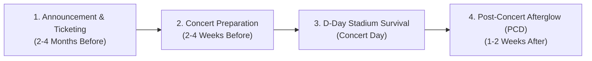

# K-Sync Malaysia: Strategic Feature Expansion Roadmap (`newfeaturee.md`)

> **Vision:** Elevate K-Sync Malaysia from an event discovery portal into the **indispensable, all-in-one daily K-Pop concert companion and fandom operating system** for Malaysia and Southeast Asia.

---

## Executive Summary: Growth & Retention Architecture

To dramatically increase user acquisition, daily active users (DAU), and word-of-mouth sharing across Instagram, TikTok, and X (Twitter), K-Sync must solve the **entire concert journey timeline**:

1. **Before:** Ticket tier ROI, budget calculator, fanchant practice.
2. **During:** Carpools, freebie distribution maps, photocard trading, stadium seat POVs.
3. **After:** Post-Concert Depression (PCD) memory vaults, automated Spotify setlist exports, digital concert passports.

---

## 🌟 Top 10 High-Impact Features

### Phase 1: High-Growth & Immediate Viral Engagement (Quick Wins)

#### 1. 🎤 Fanchant & Lyrics Practice Studio (Karaoke Engine)
- **The Fan Problem:** Fans spend hours searching YouTube for romanized lyrics and fanchants (응원법) to practice before the concert. Many struggle to memorize names and callouts during fast verses.
- **The Feature:**
  - Synchronized, karaoke-style romanized lyrics highlighting in real-time.
  - Official fanchant shouts highlighted in vibrant **K-Sync Pink / Gold**.
  - Audio sync directly tied to the 30s Tour Anthem previews or official audio.
  - One-click **"Download Printable Pocket Fanchant Sheet"** (clean PDF for printing or saving to mobile lockscreen).
- **Viral Growth Impact:** Fans screenshot their practice scores and share them on TikTok and Instagram Stories tagging K-Sync.

#### 2. 💺 Crowdsourced Seating POV & Sightline Simulator
- **The Fan Problem:** Flat ticketing seat maps (BookMyShow, GoLive, Ticket2U) don't show real views. Fans constantly ask: *"Is CAT 2 at Axiata Arena obstructed by the sound tower?"* or *"How far is Section 314 at Bukit Jalil?"*
- **The Feature:**
  - Interactive 3D / Section visualizer for Malaysia’s top concert venues:
    - **Bukit Jalil National Stadium** (85,000 cap)
    - **Axiata Arena** (16,000 cap)
    - **Mega Star Arena KL** (5,000 cap)
    - **Zepp Kuala Lumpur** (2,500 cap)
    - **Sunway Lagoon Surf Beach**
  - Fans can upload real photos/videos taken from their specific Block, Row, and Seat.
  - Rating system for: Audio Quality, Distance from Extended Stage, Obstruction Risk.
- **Retention Impact:** Becomes the mandatory tool referenced during every single ticketing war.

#### 3. 🚗 Fan Carpool & Transit Buddy Matcher ("Balik Selamat")
- **The Fan Problem:** After 11:30 PM at Bukit Jalil or Axiata, 50,000 fans rush the LRT station. Wait times exceed 90 minutes, and Grab rides surge to RM80–RM120 with zero driver availability. Out-of-state fans (Penang, JB, Ipoh) struggle to find safe transportation.
- **The Feature:**
  - Secure Fan Ride Board: Verified drivers/fans can post: *"Offering 3 seats from Bukit Jalil to Subang Jaya / PJ after SEVENTEEN concert"*.
  - **"Girls Only" Filter:** Verified female fans can join female-only carpools.
  - **Out-of-State Van / Bus Pooling:** Direct coordination for interstate concert buses (e.g., George Town &rarr; Bukit Jalil round-trip).
  - Transit safety guides: Real-time LRT operating extension announcements (e.g. RapidKL 1:00 AM operating hours).
- **Safety Impact:** Massive community trust and real-world safety benefit.

---

### Phase 2: D-Day Live Stadium Experience & Community Utility

#### 4. 🎁 Live Freebies & Fan Project Radar (Stadium Geolocation)
- **The Fan Problem:** Fanbases distribute thousands of free photocards, banners, stickers, and keychains outside stadium gates, while cafes host Cup Sleeve events. Currently, fans must scroll through messy Twitter/X hashtags to locate them.
- **The Feature:**
  - Pinpoint map of all fan project booths outside the stadium (e.g., *Gate B Tree #3: 300pcs Wonwoo Transparent Photocard from 2:00 PM*).
  - Real-time stock status: Fans can mark booths as **"Active"**, **"Low Stock"**, or **"Finished"**.
  - Local Cup Sleeve & Fan Cafe Directory for pre-concert gatherings (Pavilion Bukit Jalil, Sri Petaling, Lalaport).
- **Engagement Impact:** High mobile usage on concert day right on the festival grounds.

#### 5. 🔄 Photocard & Merch "Want-To-Trade" (WTT) Live Board
- **The Fan Problem:** Fans buy random album packs or official photocard packs at the merch booth and get duplicates. Hundreds of fans pace around the venue holding photocards shouting trades.
- **The Feature:**
  - Live venue trading wall: *"HAVE: Felix (Stray Kids), WANT: Hyunjin"*.
  - Filter by Member, Album Version, or Merchandise type.
  - Quick meeting point tagging (e.g., *"Meet at Axiata Entrance Escalator"*).
  - Anti-scam trust score tied to K-Sync user account.

#### 6. 🔦 Lightstick Command & Battery Health Hub
- **The Fan Problem:** Lightsticks (Carat Bong, Candybong, Nachimbong) die halfway through concerts due to wrong batteries (zinc-carbon vs alkaline), or fail to sync to venue Bluetooth.
- **The Feature:**
  - Lightstick guide per artist: Exact battery requirements (AAA Alkaline vs rechargeable lithium packs), pairing instructions, and firmware update links.
  - **Virtual Emergency Lightstick:** Phone screen transforms into an illuminated glowstick matching the official fandom color (e.g., Rose Quartz & Serenity for SEVENTEEN) with pulse effects for fans without physical lightsticks.

---

### Phase 3: Financial Planning & Regional Fan Tourism

#### 7. 💰 Concert Budget Calculator & Ticket Tier ROI Advisor
- **The Fan Problem:** K-Pop concerts are expensive. Fans struggle to budget total cost (Ticket + RM4 booking fee + transit/fuel + RM250 lightstick + food + hotel).
- **The Feature:**
  - Dynamic Concert Trip Estimator: Add ticket tier, merch wishlist, and transport to calculate total spend.
  - Multi-Currency converter (MYR, SGD, IDR, USD) for international fans visiting Malaysia.
  - Soundcheck & VIP Perks Comparison Matrix (is VIP Soundcheck worth the extra RM300 vs CAT 1?).

#### 8. ✈️ KL Concert Tourist Survival Guide (Regional Inbound Hub)
- **The Fan Problem:** Kuala Lumpur is a major Southeast Asian tour stop attracting tens of thousands of fans from Singapore, Indonesia, Thailand, and East Malaysia. They need hotels near transit lines, luggage storage, and halal dining.
- **The Feature:**
  - Curated LRT/MRT-connected hotels within 20 minutes of Bukit Jalil or Zepp KL.
  - Luggage drop-off lockers (KL Sentral, Pavilion Bukit Jalil, TBS Bus Terminal).
  - Recommended fan-friendly dining & late-night supper spots near stadiums.

---

### Phase 4: Post-Concert Retention & Gamified Loyalty

#### 9. 💿 Post-Concert Depression (PCD) Vault & Spotify Setlist Sync
- **The Fan Problem:** When the concert ends, fans suffer from Post-Concert Depression (PCD) and want to relive the exact live setlist and share their memories.
- **The Feature:**
  - **1-Click Playlist Generator:** Instantly exports the exact concert setlist to Spotify and Apple Music playlists.
  - **Digital Holographic Ticket Stub:** Generates a personalized commemorative digital ticket with user name, concert date, seat number, and holographic foil sheen for sharing on social media.
  - Fan Memory Wall: Verified concertgoers can upload concert fancams and memories into a persistent timeline.

#### 10. 🏅 Digital K-Sync Concert Passport & Fandom Badges
- **The Fan Problem:** Fans want recognition for their loyalty and concert attendance history.
- **The Feature:**
  - Gamified digital passport: Collect custom digital stamps for every event attended in Malaysia.
  - Unlockable badges: *"Axiata Arena Veteran (5+ concerts)"*, *"Barricade VIP"*, *"Lightstick Synchronizer"*, *"Top Community Contributor"*.
  - Level-up perks: Early access to community giveaways and verified fan flair in discussions.

---

## 🛠️ Implementation Architecture & Prioritization Matrix

| Feature | Value to Fan | Growth Velocity | Dev Complexity | Priority |
| :--- | :--- | :--- | :--- | :---: |
| **Fanchant Karaoke Studio** | ⭐⭐⭐⭐⭐ High | Viral TikTok/IG | Low - Medium | **P1 (Immediate)** |
| **Crowdsourced Seating POV** | ⭐⭐⭐⭐⭐ Essential | Ticketing Wave Traffic | Medium | **P1 (Immediate)** |
| **Fan Carpool & Transit Buddy** | ⭐⭐⭐⭐⭐ Critical Safety | High Word-of-Mouth | Medium | **P1 (Immediate)** |
| **Live Freebies & Project Radar**| ⭐⭐⭐⭐ High | Concert Day Mobile DAU | Medium | **P2 (Next)** |
| **Post-Concert Spotify Sync & Stubs**| ⭐⭐⭐⭐ Delight | Social Sharing / Pride | Low | **P2 (Next)** |
| **Photocard WTT Live Board** | ⭐⭐⭐⭐ High | Real-time Engagement | Medium | **P2 (Next)** |
| **Concert Budget & Tier ROI** | ⭐⭐⭐ Good | Pre-ticketing Utility | Low | **P3** |
| **Lightstick Hub & Virtual Screen**| ⭐⭐⭐ Good | Concert Day Utility | Low | **P3** |
| **Concert Passport & Badges** | ⭐⭐⭐⭐ Retention | Long-term Loyalty | Low - Medium | **P3** |
| **KL Fan Tourist Guide** | ⭐⭐⭐ Regional | Inbound SEA Fans | Low | **P3** |

---

## 🚀 Recommended Next Step

Start with **P1: The Pre-Concert Triple Threat**:
1. **Fanchant Practice Studio** (utilizing our existing iTunes / audio streaming engine + interactive lyrics highlighter).
2. **Crowdsourced Seating POV Directory** for Bukit Jalil & Axiata Arena.
3. **Transit & Carpool Safe Buddy Matcher** to solve the #1 complaint of all Malaysian concertgoers.
